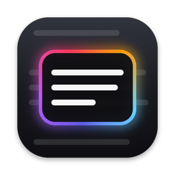
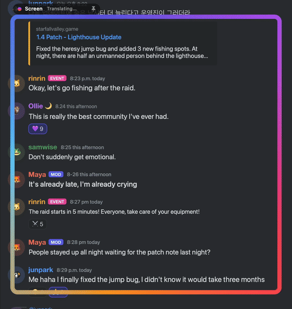

<p align="center">
  
</p>

<h1 align="center">AZET Lens</h1>
<p align="center"><a href="README.md">한국어</a> · <b>English</b> · <a href="README.ja.md">日本語</a> · <a href="README.zh-CN.md">简体中文</a></p>
<p align="center"><sub>A fork of <a href="https://github.com/midagedev/mwoyeo">Mwoyeo</a> by <a href="https://github.com/midagedev">midagedev</a> (MIT), with no network access at all and subtitle transcripts. Made by <a href="https://azet.io">AZET</a>.</sub></p>
<p align="center"><b>Read any screen in your language, right where the text is.</b><br>
Put a lens over a chat, a feed or a game. The original text disappears and the translation is written in its place.</p>

<p align="center">
  <a href="https://github.com/azet-llc/azet-lens/releases/latest"></a>
  
  
  
  <a href="LICENSE"></a>
</p>

<p align="center"></p>

AZET Lens reads the text under a lens, **erases it from the picture**, and paints the translation back in the same
place, size and colour. It is not a popup or a subtitle bar: the screen simply reads in your language, and keeps
reading as messages arrive and the page scrolls. Everything runs on your Mac; nothing on your screen is sent anywhere.

## What is different from Mwoyeo

AZET Lens is Mwoyeo with three changes. Everything else (the lens, the erasing, the engines, the glossary, the
shortcuts, the 12 languages of the app) is Mwoyeo's work, unchanged; see [docs/DIFFERENCES.md](docs/DIFFERENCES.md)
for the full comparison.

| | Mwoyeo 1.0.4 | AZET Lens |
|---|---|---|
| **Network** | One request a day to GitHub (update check and anonymous install counts), can be turned off | **None, enforced by macOS**: the app runs in the App Sandbox without the network entitlement, so the system refuses any connection it would open. No update check. [Check it yourself](#check-it-yourself) |
| **Transcript** | None (translations are reused from memory while the app runs, never saved) | Optional: each lens can keep what it translated with the time it was on screen, in memory, and save it as **subtitles (.srt)** or as text with the originals |
| **Outlined subtitles** | White letters with a black edge come out as dark text without the edge, left-aligned | The fill colour and the edge are kept, and centred lines stay centred ([measured](docs/DIFFERENCES.md#measured)) |
| Lens, erasing, engines, glossary, translation memory, shortcuts, menu bar | ✓ | Same |

## Install

Download the disk image from [Releases](https://github.com/azet-llc/azet-lens/releases/latest) and drag AZET Lens to
Applications. The app is signed by AZET LLC (Developer ID) and notarized by Apple.

AZET Lens never looks for updates, because it cannot reach the internet. New versions are announced on the
[Releases](https://github.com/azet-llc/azet-lens/releases) page: watch the repository (Watch › Custom › Releases) to
be told by GitHub.

### Requirements

| | |
|---|---|
| **macOS** | 27.0 or later |
| **Mac** | Any Mac that runs macOS 27: Apple silicon, M1 or later, or MacBook Neo. There is no Intel build. |
| **Permission** | Screen Recording, nothing else: no Accessibility, no keyboard monitoring |
| **Network** | None. The app is sandboxed without network access; language packs and the Apple Intelligence model are downloaded by macOS itself |
| **Disk** | About 20 MB for the app. Language packs (and Apple Intelligence's model, up to 8–14 GB) are downloaded and stored by macOS. |
| **Displays** | Any number; a lens can go on any display |

**What runs on device, and what it needs.** Everything runs on your Mac; the only question is which engine is there.

| Part | Needs |
|---|---|
| Reading the text (Vision), erasing it (Core ML) | Nothing more: every Mac that runs macOS 27 |
| Translating with a **language pack** (fastest, offline) | The pack for your language pair, downloaded once from AZET Lens's Settings › Translation or System Settings › General › Language & Region › Translation Languages |
| Translating **without a pack**, the *High fidelity* engine and *Glossary first* | **Apple Intelligence** turned on in System Settings › Apple Intelligence & Siri |

Apple Intelligence runs on every Mac that runs macOS 27, but it has two more conditions: your Mac's language and Siri's
language must be the same supported language, and it is not available in mainland China. It supports English,
Korean, Japanese, Chinese, French, German, Spanish, Italian, Portuguese and Vietnamese among AZET Lens's languages, but
not Russian, Ukrainian or Thai: those translate with language packs only. Without Apple Intelligence, AZET Lens uses
language packs for everything.

**Languages.** Translate from and into English, Korean, Japanese, Chinese (Simplified and Traditional), French,
German, Spanish, Italian, Portuguese (Brazil), Russian, Ukrainian, Vietnamese and Thai, in any direction macOS has a
translation model for. *Automatic* detects the source language per line. The app itself is in English, Korean,
Japanese, Chinese (Simplified and Traditional), French, German, Spanish, Italian, Portuguese (Brazil), Russian and
Ukrainian.

## Getting started

1. **Open AZET Lens.** It lives in the menu bar (the viewfinder icon); a welcome window walks you through the rest.
2. **Allow Screen Recording.** Click **Allow** and turn AZET Lens on in System Settings › Privacy & Security › Screen &
   System Audio Recording. If the lens stays empty afterwards, quit and reopen AZET Lens.
3. **Pick your languages.** *Translate from* can stay on **Automatic**; *Translate to* starts as your Mac's language.
4. **Get the language pack** (recommended). In AZET Lens's Settings › Translation, click **Download** next to your
   language pair. With a pack, translation is near-instant and works offline. Without one, Apple Intelligence
   translates instead, which needs no download but takes about half a second per line.
5. **Press ⌃⌥L and drag a box** over the text you want to read, such as the message list of a Discord channel or a
   Reddit thread. Or just click, and a lens is dropped where you clicked. Hold ⌥ while you do it to pin the lens to
   the screen instead of the window (see below).

## Using a lens

- **Move it** by dragging its glowing edge or the name tag on top. Translations stay on the text underneath; only
  what is inside the lens is shown.
- **Resize it** from the bottom-right corner.
- **Close it** with the ✕ on the name tag (hover over the lens to see it).
- **Scroll and chat as usual.** The interior of a lens is click-through, so the page under it works normally. New
  messages are translated as they arrive and scrolling carries the translations along.
- **Window lens or screen lens.** A lens placed on a window is a *window lens* (🪟 on its name tag): it moves with
  that window and hides while the window is minimized or covered. A *screen lens* (📌) stays where you put it and
  translates whatever is under it, whichever app that is: handy for a subtitle line or a spot you keep switching
  apps under. Click the icon on the name tag to switch.
- **Keep lenses small.** A lens around just the part you read (the chat, not the whole browser) translates faster
  and uses less power. You can have several.

The menu bar icon lists your lenses: switch each one on or off, remove it, or add a new one. It also has
**Show Original**, **Pause** and Settings.

### Shortcuts

These work in any app. Change or remove them in Settings › Shortcuts: click a shortcut and press the new keys.
macOS can't tell an app when another one already uses the same keys, so if a shortcut also does something
elsewhere, record a different one. The defaults stay clear of window managers such as Rectangle and Magnet.

| | |
|---|---|
| ⌃⌥L | Add a lens (drag an area, or click to drop one; hold ⌥ to pin it to the screen) |
| ⌃⌥O | Show the original / the translation |
| ⌃⌥M | Open the menu panel (also when a full menu bar hides the icon behind the notch; opening the app again does the same) |
| none | Pause all lenses, Translate again (in the menu; give them keys in Settings if you like) |

## Settings

| Tab | What you can change |
|---|---|
| General | Languages · **Display**: *Adaptive* (default: plain boxes while things move, a seamless rewrite once still), *Quick* (always boxes, least battery) or *Seamless* (always rewrites) · how often the screen is checked (4, 8 or 15 fps) · open at login |
| Translation | **Engine**: *Automatic* (language pack if installed, Apple Intelligence otherwise), *High fidelity* (always Apple Intelligence) or *Glossary first* · language packs · **translation memory**: how many translations to keep for reuse (1,000, 5,000 or 20,000; in memory only, cleared when AZET Lens quits) · a **glossary** of names, one `original = translation` per line |
| Appearance | **Lens style**: *Glow*, *Subtle* (glows only while reading) or *Minimal* (a faint line; the name tag shows on hover) · font (default, rounded, serif) · box opacity · AI erasing on photos and artwork |

## Tips and troubleshooting

- **Stuck on "Translating…"?** Usually the language pack is missing; download it in Settings › Translation. The very
  first lens after installing also takes a while, because macOS loads its text recognition models once.
- **Names come out wrong** (characters, places, usernames)? Add them to the glossary and choose *Glossary first*.
- **Nothing shows up after an update?** macOS sometimes asks for Screen Recording again. Check it in System Settings,
  then reopen AZET Lens.
- **Want to compare with the original?** Press ⌃⌥O to see the original, and again to go back.
- **Privacy.** AZET Lens reads only what is under a lens and leaves its own overlays out of what it captures. It
  sends nothing, ever: it has no network access (see below). It keeps nothing either, unless you turn on the transcript,
  which stays in memory until you save it to a file you choose.

## Transcripts and subtitles

Turn on **Settings › General › Keep a transcript of each lens**. From then on each lens keeps every line it
translates, with the time the line was on screen. A lens with a transcript shows a 💬 count in the menu; click it to
save:

- **.srt**: SubRip subtitles of the translations, timed from when the transcript began. Put a lens over the subtitle
  line of a video, play it through, save, and you have translated subtitles for that video.
- **.txt**: the time, the translation and the original under it, line by line.

The transcript lives in memory only. Turning the setting off, removing the lens or quitting deletes it; nothing is
written to disk until you pick a file in the Save panel, and the app can write only to the file you picked.

## Check it yourself

The network promise is not a setting you have to trust: it is in the app's code signature, which macOS enforces.

```bash
codesign -d --entitlements - "/Applications/AZET Lens.app"
```

The output lists `com.apple.security.app-sandbox` and `com.apple.security.files.user-selected.read-write` and nothing
else: there is no `com.apple.security.network.client`, so the sandbox refuses every outgoing connection. To watch it,
run `nettop -p "AZET Lens"` while a lens translates; the process never appears with a connection. Language packs and
the Apple Intelligence model are downloaded by macOS's own services, not by the app. See [SECURITY.md](SECURITY.md).

## Under the hood

Every stage uses Apple's on-device frameworks:

| Stage | Technology |
|---|---|
| Capture | ScreenCaptureKit — one stream per lens, AZET Lens's own overlays excluded, frames only when pixels change |
| Text recognition | Vision `RecognizeDocumentsRequest` (paragraphs) and `RecognizeTextRequest` (lines, regions of interest) |
| Translation | Translation framework — low-latency language packs, or the high-fidelity Apple Intelligence model without a pack |
| Glossary-aware translation | Foundation Models (on-device language model), optional |
| Erasing | Core ML MI-GAN inpainting on the GPU for textured backgrounds, a fast diffusion fill for flat ones |
| Interface | SwiftUI with Liquid Glass, a menu bar extra, global shortcuts, in 12 languages |

### How it works

```
ScreenCaptureKit ──► change map (16 px tiles) ──► scroll? shift blocks, read only the new strip
      │                       │
      │                       └─► changed rows ──► Vision (ROI) ──► erase ──► translate (lens first) ──► overlay
      │
      └─► still for 0.5 s ──► whole-frame paragraph pass ──► seamless re-render, cross-faded in
```

The capture is larger than the lens ("overscan"). At rest the margin is about 30 % of the lens on each side; while
content or the lens moves it grows to about 40 %, shifted toward where things are heading. The lens moves freely
inside the captured area and the capture only re-centres when the lens nears its edge — then just the uncovered strips are read. Unchanged text keeps its
erased background across passes, results computed while content moved are shifted rather than thrown away, and the
translation queue always serves what is visible first.

Scrolling is tracked twice. Trackpad and wheel input move the translations with the page before the next frame
arrives; each captured frame then settles them to the exact offset, measured per column to a fraction of a pixel, so
a fixed sidebar or message box never drags the chat along with it. Only the strip that scrolled into view is read.

Erasing fills flat and gradient backgrounds from their surroundings; on textured ones (artwork, game scenes) an
on-device inpainting model rebuilds the background, and the translation is set in a matching weight and size.

The clip above is Mwoyeo, which AZET Lens is built on, on a made-up chat page (`demo/chat.html?lang=ko`), recorded with a real mouse and
trackpad scrolls; `docs/HERO.md` has the shot list.

The name is Korean: *mwoyeo* (뭐여) is a dialect way of saying "what's that?"

## Development

### Building

```bash
brew install xcodegen
xcodegen generate
xcodebuild -project Mwoyeo.xcodeproj -scheme Mwoyeo -configuration Release -derivedDataPath build/dd build
```

Builds are ad-hoc signed by default, which makes macOS ask for Screen Recording again after every rebuild. Put a
stable identity in `Config/Local.xcconfig` (git-ignored):

```
MWOYEO_SIGN_IDENTITY = <SHA-1 from `security find-identity -v -p codesigning`>
MWOYEO_TEAM = <team id>
```

Core logic (change detection, scroll detection, erasing masks, outlined-text detection, line alignment, text fitting,
overscan planning, transcripts) lives in the `MwoyeoCore` package with its own tests: `cd Core && swift test`.

Release builds are sandboxed (`App/Lens.entitlements`); Debug builds are not (`App/Mwoyeo.entitlements`), so that the
headless harness below can read and write any path. Build with `-configuration Debug` to use it.

#### Headless checks

The app binary doubles as a test harness that runs the real pipeline on images:

```bash
APP="build/dd/Build/Products/Debug/AZET Lens.app/Contents/MacOS/AZET Lens"
$APP --render in.png out.png --src ja --tgt ko                     # one still: read, erase, translate, composite
$APP --render in.png out.png --src ja --tgt ko --srt out.srt       # … and the transcript a lens would save
$APP --render page.png frames/ --pan --src ja --tgt ko \
     --lens 200,560,600,300 --to 200,860                            # simulated lens drag, one PNG per step
$APP --render page.png frames/ --pan --scroll --src ja --tgt ko \
     --lens 200,300,600,300 --to 0,400                              # simulated scroll under a still lens
```

`MWOYEO_TRACE=1` prints stage timings; in the live app `MWOYEO_DUMP=<dir>` writes what each lens captured with its
overlay on top.

#### Releasing

`scripts/release.sh <version> [--publish]` builds, signs with AZET LLC's Developer ID, refuses a build that is not
sandboxed or has a network entitlement, notarizes and staples the disk image, and publishes the GitHub release. It
runs on AZET's release Mac only; the signing key is not in CI or in repository secrets.

#### Demo pages

`demo/chat.html` (a Discord-like server) and `demo/forum.html` (a Reddit-like thread) are made-up pages for
recordings; their parameters (language, new-message rate, scripted scrolls) are listed at the top of each file.
`docs/HERO.md` has the shot list.

## Credits

AZET Lens is built on [Mwoyeo](https://github.com/midagedev/mwoyeo) by [midagedev](https://github.com/midagedev), MIT
licensed: the lens, the capture and change tracking, the erasing, the translation engines and the interface are
their work. Thank you. If you only want the original, get it there.

Inpainting model: [MI-GAN](https://github.com/Picsart-AI-Research/MI-GAN) by Picsart AI Research, MIT licensed
(`tools/inpaint/models/LICENSE-MI-GAN-WEIGHTS`). The Core ML version in `tools/inpaint/models` was converted with
`tools/inpaint/convert_migan.sh`.

## More from AZET

AZET makes privacy and security apps that keep your data on your device:
[Sweep](https://azet.io/products/sweep) (blocks ads, trackers and scam sites) ·
[AZET Pass](https://azet.io/products/pass) (password manager, end-to-end encrypted) ·
[AZET Care](https://azet.io/products/care-mac) (Mac, Windows, iPhone and Android checkup) ·
[AZET Shield](https://azet.io/products/shield). Questions: hello@azet.io.

## License

MIT
