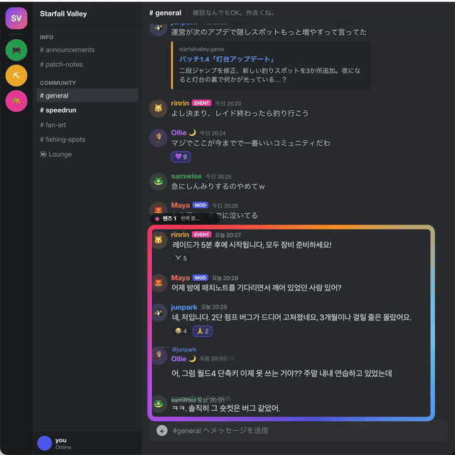

<p align="center">
  
</p>

<h1 align="center">Mwoyeo</h1>
<p align="center"><a href="README.md">한국어</a> · <a href="README.en.md">English</a> · <b>日本語</b> · <a href="README.zh-CN.md">简体中文</a></p>
<p align="center"><b>どんな画面も、文字があるその場所で、あなたの言語で読めます。</b><br>
チャットやフィード、ゲームにレンズを重ねるだけ。元のテキストが消え、同じ場所に翻訳が書き込まれます。</p>

<p align="center">
  <code>brew install midagedev/tap/mwoyeo</code><br>
  <sub>macOS 27 · Appleシリコン · すべてデバイス上で処理 · <a href="https://github.com/midagedev/mwoyeo/releases/latest">v1.0.2</a></sub>
</p>

<p align="center"></p>

Mwoyeoはレンズの下のテキストを読み取り、**画像からそのテキストを消して**、同じ位置・サイズ・色で翻訳を描き直します。ポップアップでも字幕バーでもありません。画面がそのままあなたの言語で読めるようになり、メッセージが届いてもページをスクロールしても、そのまま読み続けられます。処理はすべてあなたのMac上で行われ、画面の内容がどこかへ送られることはありません。

## インストール

```bash
brew install midagedev/tap/mwoyeo
```

または[Releases](https://github.com/midagedev/mwoyeo/releases/latest)からディスクイメージをダウンロードし、Mwoyeoをアプリケーションフォルダにドラッグしてください。アプリは署名済みで、Appleの公証も受けています。

Mwoyeoは1日1回GitHubで新しいバージョンを確認し、あればメニューでお知らせします。アップデートは`brew upgrade mwoyeo`を実行するか、新しいディスクイメージをダウンロードしてください。設定 › 情報で、アップデートの確認、自動確認のオン/オフ、リリースノートと問題報告ページへのリンクを利用できます。

### 動作環境

| | |
|---|---|
| **macOS** | 27.0以降 |
| **Mac** | macOS 27が動作するすべてのMac（Appleシリコン M1以降、またはMacBook Neo）。Intel版はありません。 |
| **許可** | 画面収録のみ。アクセシビリティやキーボード入力の監視は不要です |
| **ネットワーク** | 翻訳には不要です。通信は1日1回のアップデート確認だけで、オフにもできます。 |
| **ディスク** | アプリ本体は約20 MB。言語パック（およびApple Intelligenceのモデル、最大8〜14 GB）はmacOSがダウンロードして保存します。 |
| **ディスプレイ** | 台数に制限はなく、どのディスプレイにもレンズを置けます |

**デバイス上で動くものと、その条件。** 処理はすべてあなたのMac上で行われます。違いは、どのエンジンが使えるかだけです。

| 機能 | 必要なもの |
|---|---|
| テキストの読み取り（Vision）、消去（Core ML） | 追加の条件なし。macOS 27が動作するすべてのMac |
| **言語パック**による翻訳（最速・オフライン対応） | 使う言語ペアの言語パック。Mwoyeoの設定 › 翻訳、またはシステム設定 › 一般 › 言語と地域 › 翻訳言語から一度ダウンロードします |
| **言語パックなし**での翻訳、*高品質*エンジン、*用語集を優先* | システム設定 › Apple IntelligenceとSiri で **Apple Intelligence** をオンにすること |

Apple IntelligenceはmacOS 27が動作するすべてのMacで使えますが、条件がさらに2つあります。Macの言語とSiriの言語が同じ対応言語であること、そして中国本土では利用できないことです。Mwoyeoの対応言語のうち、英語、韓国語、日本語、中国語、フランス語、ドイツ語、スペイン語、イタリア語、ポルトガル語、ベトナム語に対応していますが、ロシア語、ウクライナ語、タイ語には対応していません。これらの言語は言語パックでのみ翻訳されます。Apple Intelligenceが使えない場合、Mwoyeoはすべての翻訳に言語パックを使います。

**言語。** 英語、韓国語、日本語、中国語（簡体字・繁体字）、フランス語、ドイツ語、スペイン語、イタリア語、ポルトガル語（ブラジル）、ロシア語、ウクライナ語、ベトナム語、タイ語の間で、macOSに翻訳モデルがある組み合わせならどの方向にも翻訳できます。*自動*を選ぶと、翻訳元の言語を行ごとに判別します。アプリ自体は英語、韓国語、日本語、中国語（簡体字・繁体字）、フランス語、ドイツ語、スペイン語、イタリア語、ポルトガル語（ブラジル）、ロシア語、ウクライナ語で表示できます。

## はじめに

1. **Mwoyeoを開きます。** アプリはメニューバー（ビューファインダーのアイコン）に常駐します。以降の手順はウェルカムウインドウが案内します。
2. **画面収録を許可します。** **許可**をクリックし、システム設定 › プライバシーとセキュリティ › 画面収録とシステムオーディオ録音 でMwoyeoをオンにします。その後もレンズに何も表示されない場合は、Mwoyeoを終了して開き直してください。
3. **言語を選びます。** *翻訳元*は**自動**のままで構いません。*翻訳先*は最初、Macの言語になっています。
4. **言語パックを入手します**（推奨）。Mwoyeoの設定 › 翻訳で、使う言語ペアの横にある**ダウンロード**をクリックします。言語パックがあれば翻訳はほぼ一瞬で、オフラインでも動きます。言語パックがない場合はApple Intelligenceが代わりに翻訳します。ダウンロードは不要ですが、1行あたり約0.5秒かかります。
5. **⌃⌥Lを押して範囲をドラッグします。** Discordチャンネルのメッセージ一覧やRedditのスレッドなど、読みたいテキストの上を囲んでください。クリックするだけでも、その場所にレンズが置かれます。このとき⌥を押したままにすると、レンズがウインドウではなく画面に固定されます（後述）。

## レンズの使い方

- **移動**は、光っている枠か上部の名札をドラッグします。翻訳は下のテキストに付いたままで、レンズの内側の分だけが表示されます。
- **サイズ変更**は右下の角から行います。
- **閉じる**には、名札の✕をクリックします（レンズにポインタを重ねると表示されます）。
- **スクロールもチャットもいつもどおり。** レンズの内側はクリックが下に通るので、下のページは普通に操作できます。新しいメッセージは届いたそばから翻訳され、スクロールすると翻訳も一緒に動きます。
- **ウインドウレンズと画面レンズ。** ウインドウの上に置いたレンズは*ウインドウレンズ*（名札に🪟）で、そのウインドウと一緒に動き、ウインドウがしまわれたり隠れたりしている間は非表示になります。*画面レンズ*（📌）は置いた場所にとどまり、下にあるものをアプリを問わず翻訳します。字幕の行や、アプリを切り替えながら見る場所に便利です。名札のアイコンをクリックすると切り替わります。
- **レンズは小さめに。** 読む部分だけを囲んだレンズ（ブラウザ全体ではなくチャット部分だけ）のほうが翻訳が速く、電力も少なく済みます。レンズは複数置けます。

メニューバーのアイコンにはレンズの一覧があり、レンズごとのオン/オフ、削除、新しいレンズの追加ができます。**元のテキストを表示**、**一時停止**、設定もここにあります。

### ショートカット

どのアプリでも使えます。設定 › ショートカットで変更や削除ができます。ショートカットをクリックして、新しいキーを押してください。ほかのアプリがすでに同じキーを使っていても、macOSはそれをアプリに知らせられません。ショートカットがほかの場所でも別の操作をする場合は、別の組み合わせを記録してください。デフォルトのキーは、RectangleやMagnetなどのウインドウ管理アプリと重ならないようにしてあります。

| | |
|---|---|
| ⌃⌥L | レンズを追加（範囲をドラッグ、またはクリックして配置。⌥を押したままで画面に固定） |
| ⌃⌥O | 原文 / 翻訳の表示を切り替え |
| なし | すべてのレンズを一時停止、もう一度翻訳（メニューから。必要なら設定でキーを割り当てられます） |

## 設定

| タブ | 変更できる項目 |
|---|---|
| 一般 | 言語 · **表示方法**: *適応型*（デフォルト。動いている間は単純なボックス、止まるとシームレスに書き直し）、*クイック*（常にボックス、バッテリー消費が最小）、*シームレス*（常に書き直し） · 画面をチェックする頻度（4、8、15 fps） · ログイン時に開く |
| 翻訳 | **エンジン**: *自動*（言語パックがあれば言語パック、なければApple Intelligence）、*高品質*（常にApple Intelligence）、*用語集を優先* · 言語パック · **翻訳メモリ**: 再利用のために保持する翻訳の数（1,000、5,000、20,000。メモリ上のみで、Mwoyeoを終了すると消去） · 固有名詞の**用語集**（1行に1つ`原文 = 訳文`） |
| 外観 | **レンズ**: *グロー*、*控えめ*（読み取り中だけ光る）、*ミニマル*（細い線のみ。名札はポインタを重ねると表示） · フォント（デフォルト、丸ゴシック、セリフ） · ボックスの不透明度 · 写真やイラストのAI消去 |

## ヒントとトラブルシューティング

- **「翻訳中…」のまま進まない？** たいていは言語パックがないのが原因です。設定 › 翻訳でダウンロードしてください。また、インストール後最初のレンズは、macOSがテキスト認識モデルを一度読み込むため、少し時間がかかります。
- **名前がおかしく訳される**（キャラクター名、地名、ユーザー名など）？ 用語集に追加して、*用語集を優先*を選んでください。
- **アップデート後に何も表示されない？** macOSが画面収録の許可を再度求めることがあります。システム設定で確認してから、Mwoyeoを開き直してください。
- **原文と見比べたい？** ⌃⌥Oで原文を表示し、もう一度押すと翻訳に戻ります。
- **プライバシー。** Mwoyeoはレンズの下にあるものだけを読み取り、保存も送信もしません。自分のオーバーレイはキャプチャ対象から除外しています。インターネットに問い合わせるのは1日1回、GitHubの最新バージョン番号だけで、これも設定 › 情報でオフにできます。

## 内部の仕組み

すべての段階でAppleのオンデバイスフレームワークを使っています。

| 段階 | 技術 |
|---|---|
| キャプチャ | ScreenCaptureKit — レンズごとに1ストリーム、Mwoyeo自身のオーバーレイは除外、ピクセルが変化したときだけフレームを取得 |
| テキスト認識 | Vision `RecognizeDocumentsRequest`（段落）と`RecognizeTextRequest`（行、関心領域） |
| 翻訳 | Translationフレームワーク — 低遅延の言語パック、言語パックがない場合は高品質なApple Intelligenceのモデル |
| 用語集に沿った翻訳 | Foundation Models（オンデバイスの言語モデル）、オプション |
| 消去 | 模様のある背景にはGPU上のCore ML MI-GANによるインペインティング、平坦な背景には高速な拡散塗りつぶし |
| インターフェイス | Liquid Glassを使ったSwiftUI、メニューバーエクストラ、グローバルショートカット、12言語対応 |

### 処理の流れ

```
ScreenCaptureKit ──► change map (16 px tiles) ──► scroll? shift blocks, read only the new strip
      │                       │
      │                       └─► changed rows ──► Vision (ROI) ──► erase ──► translate (lens first) ──► overlay
      │
      └─► still for 0.5 s ──► whole-frame paragraph pass ──► seamless re-render, cross-faded in
```

キャプチャ範囲はレンズより大きく取っています（「オーバースキャン」）。静止中の余白はレンズの各辺に対して約30 %で、コンテンツやレンズが動いている間は約40 %に広がり、動いていく方向に寄せられます。レンズはキャプチャ範囲の中を自由に動き、端に近づいたときだけキャプチャの中心を合わせ直します。そのときも、新たに現れた帯の部分だけを読み取ります。変化していないテキストは処理をまたいで消去済みの背景を保ち、コンテンツが動いている間に計算した結果は捨てずにずらして使い、翻訳キューは常に表示中のものを優先します。

スクロールは二重に追跡します。トラックパッドやホイールの入力で、次のフレームが届く前に翻訳をページと一緒に動かします。その後、キャプチャした各フレームで、列ごとにピクセル未満の精度で測ったオフセットに正確に合わせます。そのため、固定されたサイドバーやメッセージ入力欄がチャットを一緒に引きずることはありません。読み取るのは、スクロールで新たに見えた帯の部分だけです。

消去では、単色やグラデーションの背景は周囲の色で塗りつぶします。模様のある背景（イラストやゲーム画面）では、オンデバイスのインペインティングモデルが背景を描き直し、翻訳は元の文字に合った太さとサイズで組まれます。

上の動画は、架空のチャットページ（`demo/chat.html?lang=ja`）の上で実際のアプリを動かし、実際のマウスとトラックパッドのスクロールで収録したものです。撮影リストは`docs/HERO.md`にあります。

名前は韓国語です。*mwoyeo*（뭐여）は「なにそれ？」を意味する方言です。

## 開発

ビルド、テスト、リリースの手順は[英語版README](README.en.md#development)をご覧ください。

## クレジット

インペインティングモデル: Picsart AI Researchの[MI-GAN](https://github.com/Picsart-AI-Research/MI-GAN)、MITライセンス（`tools/inpaint/models/LICENSE-MI-GAN-WEIGHTS`）。`tools/inpaint/models`にあるCore ML版は`tools/inpaint/convert_migan.sh`で変換したものです。

## ライセンス

MIT
