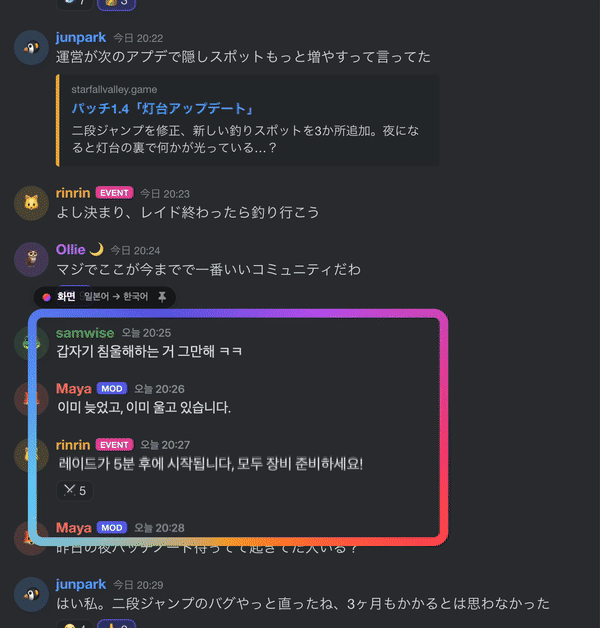

<p align="center">
  
</p>

<h1 align="center">AZET Lens</h1>
<p align="center"><b>한국어</b> · <a href="README.en.md">English</a> · <a href="README.ja.md">日本語</a> · <a href="README.zh-CN.md">简体中文</a></p>
<p align="center"><sub><a href="https://github.com/midagedev">midagedev</a>의 <a href="https://github.com/midagedev/mwoyeo">Mwoyeo</a>(MIT)를 바탕으로 네트워크를 아예 막고 자막 기록을 더한 포크예요. 만든 곳: <a href="https://azet.io">AZET</a></sub></p>
<p align="center"><b>화면 속 외국어를 그 자리에서 한국어로.</b><br>
채팅이든 피드든 게임이든 렌즈만 올려 두면 원문은 지워지고 그 자리에 번역이 들어가요.</p>

<p align="center">
  <a href="https://github.com/azet-llc/azet-lens/releases/latest"></a>
  
  
  
  <a href="LICENSE"></a>
</p>

<p align="center"></p>

번역 팝업도, 화면 아래 자막 줄도 없어요. AZET Lens는 렌즈 아래 글자를 읽어서 **화면에서 지우고** 같은 자리에 같은
크기와 색으로 번역을 다시 써요. 그래서 원래 한국어로 된 화면을 보는 것처럼 읽히고 새 메시지가 올라오거나
페이지를 스크롤해도 계속 그렇게 보여요. 모든 처리는 Mac 안에서 끝나고 화면 내용은 어디에도 보내지 않아요.

## Mwoyeo와 다른 점

AZET Lens는 Mwoyeo에서 세 가지만 바꿨어요. 렌즈, 글자 지우기, 번역 엔진, 용어집, 단축키, 12개 언어 화면 같은
나머지는 모두 Mwoyeo가 만든 그대로예요. 전체 비교는 [docs/DIFFERENCES.md](docs/DIFFERENCES.md)에 있어요.

| | Mwoyeo 1.0.4 | AZET Lens |
|---|---|---|
| **네트워크** | 하루 한 번 GitHub에 요청(업데이트 확인·익명 설치 수), 끌 수 있음 | **없음, macOS가 막음.** 네트워크 권한 없는 App Sandbox에서 돌아서 앱이 여는 연결은 시스템이 전부 거절해요. 업데이트 확인도 없어요. [직접 확인하기](#직접-확인하기) |
| **기록** | 번역을 보여 주기만 함 | 켜면 렌즈마다 번역한 줄과 화면에 있던 시간을 메모리에 모아 두고 **자막 파일(.srt)**이나 원문이 같이 적힌 텍스트로 저장 |
| **테두리 자막** | 흰 글자에 검은 테두리 자막이 테두리 없는 어두운 글자, 왼쪽 정렬로 바뀜 | 글자 색과 테두리를 그대로, 가운데 정렬 자막은 가운데로([실측](docs/DIFFERENCES.md#measured)) |
| 렌즈·지우기·엔진·용어집·번역 메모리·단축키·메뉴 막대 | ✓ | 같음 |

## 설치

[Releases](https://github.com/azet-llc/azet-lens/releases/latest)에서 디스크 이미지를 받아 AZET Lens를 응용 프로그램
폴더로 옮기면 돼요. AZET LLC 개발자 ID로 서명하고 Apple 공증을 받은 앱이에요.

AZET Lens는 인터넷에 닿을 수 없어서 업데이트를 스스로 확인하지 않아요. 새 버전은
[Releases](https://github.com/azet-llc/azet-lens/releases)에 올라오고, 저장소를 Watch › Custom › Releases로 구독하면
GitHub가 알려 줘요.

### 지원 환경

| | |
|---|---|
| **macOS** | 27.0 이상 |
| **Mac** | macOS 27이 설치되는 Mac이면 다 돼요. Apple silicon(M1 이상)이나 MacBook Neo이고 Intel 버전은 없어요. |
| **권한** | 화면 기록만 있으면 돼요. 손쉬운 사용 권한이나 키 입력 감시는 쓰지 않아요. |
| **네트워크** | 쓰지 않아요. 네트워크 권한 없는 샌드박스 앱이에요. 언어 팩과 Apple Intelligence 모델은 macOS가 직접 받아요. |
| **용량** | 앱은 20MB 정도예요. 언어 팩과 Apple Intelligence 모델(최대 8~14GB)은 macOS가 따로 받아서 관리해요. |
| **디스플레이** | 여러 대를 연결해도 어느 화면에나 렌즈를 놓을 수 있어요. |

**어떤 기능에 무엇이 필요한가요?** 어느 경우든 처리는 Mac 안에서 끝나요. 쓸 수 있는 번역 엔진만 달라져요.

| 기능 | 필요한 것 |
|---|---|
| 글자 인식(Vision), 원문 지우기(Core ML) | 따로 필요한 것 없음. macOS 27이 설치되는 Mac이면 다 돼요. |
| **언어 팩**으로 번역(가장 빠르고 오프라인에서도 됨) | 해당 언어 쌍의 언어 팩. AZET Lens 설정 › 번역이나 시스템 설정 › 일반 › 언어 및 지역 › 번역 언어에서 한 번만 받으면 돼요. |
| 언어 팩 **없이** 번역, *고품질* 엔진, *용어집 우선* | 시스템 설정 › Apple Intelligence 및 Siri에서 **Apple Intelligence**를 켜 두세요. |

Apple Intelligence는 macOS 27이 설치되는 Mac이면 어디서나 돌아가요. 다만 Mac 언어와 Siri 언어를 지원 언어 하나로
똑같이 맞춰야 하고 중국 본토에서는 쓸 수 없어요. AZET Lens가 다루는 언어 가운데 영어, 한국어, 일본어, 중국어,
프랑스어, 독일어, 스페인어, 이탈리아어, 포르투갈어, 베트남어는 Apple Intelligence가 지원해요. 러시아어,
우크라이나어, 태국어는 지원하지 않아서 언어 팩으로만 번역돼요. Apple Intelligence를 끄고 써도 괜찮아요. 그때는
모든 번역을 언어 팩이 맡아요.

**지원 언어.** 영어, 한국어, 일본어, 중국어(간체·번체), 프랑스어, 독일어, 스페인어, 이탈리아어, 포르투갈어(브라질),
러시아어, 우크라이나어, 베트남어, 태국어 가운데 macOS에 번역 모델이 있는 조합이면 어느 방향으로든 번역해요.
원문 언어를 *자동*으로 두면 줄마다 알아서 판단해요. 앱 화면은 영어, 한국어, 일본어, 중국어(간체·번체), 프랑스어,
독일어, 스페인어, 이탈리아어, 포르투갈어(브라질), 러시아어, 우크라이나어로 나와요.

## 시작하기

1. **AZET Lens를 실행해요.** 메뉴 막대에 뷰파인더 아이콘이 생기고 환영 창이 나머지를 차례로 안내해요.
2. **화면 기록을 허용해요.** **허용하기**를 누른 다음 시스템 설정 › 개인정보 보호 및 보안 › 화면 및 시스템 오디오
   녹음에서 AZET Lens를 켜세요. 그래도 렌즈가 비어 있으면 AZET Lens를 껐다가 다시 켜 주세요.
3. **언어를 골라요.** *원문*은 **자동**으로 두면 되고 *번역*은 처음부터 Mac 언어로 맞춰져 있어요.
4. **언어 팩을 받아요**(권장). AZET Lens 설정 › 번역에서 언어 쌍 옆의 **내려받기**를 누르세요. 언어 팩이 있으면
   번역이 거의 바로 나오고 인터넷이 끊겨도 돼요. 없으면 Apple Intelligence가 대신 번역해요. 받을 건 없지만 한 줄에
   0.5초쯤 걸려요.
5. **⌃⌥L을 누르고 읽고 싶은 곳을 드래그해요.** 디스코드 채널의 메시지 목록이나 레딧 스레드 같은 곳이요. 드래그
   대신 클릭하면 클릭한 자리에 렌즈가 놓여요. 이때 ⌥를 누르고 있으면 렌즈가 창이 아니라 화면에 고정돼요(아래 참고).

## 렌즈 쓰는 법

- **옮기기:** 빛나는 테두리나 위쪽 이름표를 끌어요. 번역은 아래 글자에 붙어 있어서 렌즈 안에 들어온 부분만 보여요.
- **크기 조절:** 오른쪽 아래 모서리를 끌어요.
- **닫기:** 렌즈에 포인터를 올리면 이름표에 ✕가 나타나요.
- **스크롤도 채팅도 평소처럼.** 렌즈 안쪽은 클릭이 그대로 통과해서 아래 페이지를 그냥 쓰면 돼요. 새 메시지는
  올라오는 대로 번역되고 스크롤하면 번역도 같이 따라와요.
- **창 렌즈와 화면 렌즈.** 창 위에 놓은 렌즈는 *창 렌즈*예요(이름표에 🪟). 창을 옮기면 따라오고 창을 최소화하거나
  다른 창이 가리면 숨어요. *화면 렌즈*(📌)는 놓은 자리에 계속 있으면서 아래에 어떤 앱이 오든 번역해요. 자막이
  나오는 줄이나 여러 앱을 번갈아 띄우는 자리에 좋아요. 이름표의 아이콘을 누르면 둘 사이를 바꿀 수 있어요.
- **렌즈는 작게.** 브라우저 전체보다 채팅 영역처럼 실제로 읽는 부분만 감싸야 번역이 빠르고 배터리도 덜 써요.
  렌즈는 여러 개 띄울 수 있어요.

메뉴 막대 아이콘을 누르면 렌즈 목록이 나와요. 여기서 렌즈를 하나씩 켜고 끄거나 지우고 새로 추가할 수 있어요.
**원문 보기**, **일시정지**, 설정도 이 메뉴에 있어요.

### 단축키

어느 앱을 쓰고 있든 동작해요. 설정 › 단축키에서 바꾸고 싶은 단축키를 누른 다음 새 키를 입력하면 돼요. 지울 수도
있어요. 다른 앱이 이미 같은 키를 쓰고 있어도 macOS는 알려 주지 않아요. 단축키를 눌렀는데 다른 일이 같이 일어나면
다른 키로 바꿔 주세요. 기본 단축키는 Rectangle이나 Magnet 같은 창 관리 앱과 겹치지 않게 골랐어요.

| | |
|---|---|
| ⌃⌥L | 렌즈 추가(드래그해서 영역 지정, 클릭하면 그 자리에 놓기, ⌥를 누르고 있으면 화면에 고정) |
| ⌃⌥O | 원문 보기 / 번역 보기 |
| 없음 | 모든 렌즈 일시정지, 다시 번역(메뉴에 있어요. 필요하면 설정에서 키를 지정하세요) |

## 설정

| 탭 | 바꿀 수 있는 것 |
|---|---|
| 일반 | 언어 · **표시 방식**: *적응형*(기본값. 움직이는 동안엔 상자로 보여 주고 멈추면 원문을 지우고 다시 씀), *빠르게*(늘 상자, 배터리를 가장 적게 씀), *자연스럽게*(늘 지우고 다시 씀) · 화면 확인 빈도(4, 8, 15fps) · 로그인 시 실행 |
| 번역 | **엔진**: *자동*(언어 팩이 있으면 언어 팩, 없으면 Apple Intelligence), *고품질*(늘 Apple Intelligence), *용어집 우선* · 언어 팩 · **번역 메모리**: 한 번 번역한 문장을 몇 개까지 기억해 둘지(1,000, 5,000, 20,000개. 메모리에만 두고 AZET Lens를 끄면 사라져요) · 이름을 정해 두는 **용어집**(한 줄에 `원문 = 번역` 하나씩) |
| 표시 | **렌즈 스타일**: *글로우*, *은은하게*(읽는 동안에만 빛나요), *최소*(옅은 선만 보이고 이름표는 포인터를 올리면 나타나요) · 글꼴(기본, 둥근, 명조) · 상자 불투명도 · 사진이나 그림 위 글자는 AI로 지우기 |

## 자주 겪는 문제

- **"번역 중…"에서 넘어가지 않아요.** 대부분 언어 팩이 없어서 그래요. 설정 › 번역에서 받아 주세요. 설치하고 처음
  띄우는 렌즈는 원래 좀 오래 걸려요. macOS가 글자 인식 모델을 처음 한 번 불러오거든요.
- **이름이 엉뚱하게 번역돼요.** 등장인물이나 지명, 닉네임 같은 건 용어집에 적고 *용어집 우선*을 고르세요.
- **업데이트했더니 아무것도 안 보여요.** macOS가 화면 기록 권한을 다시 물어볼 때가 있어요. 시스템 설정에서
  확인하고 AZET Lens를 다시 켜 주세요.
- **원문이랑 비교해 보고 싶어요.** ⌃⌥O를 누르면 원문이 보이고 한 번 더 누르면 번역으로 돌아와요.
- **개인정보는요?** AZET Lens는 렌즈 아래만 읽고 화면을 캡처할 때 자기 오버레이는 빼고 찍어요. 아무것도 보내지
  않아요. 네트워크 권한이 아예 없어요(아래 참고). 기록을 켜지 않으면 아무것도 남기지 않고, 켜도 직접 고른 파일로
  저장하기 전까지는 메모리에만 있어요.

## 기록과 자막 저장

**설정 › 일반 › 렌즈마다 기록 남기기**를 켜면 렌즈가 번역한 줄을 화면에 있던 시간과 함께 모아 둬요. 기록이 있는
렌즈는 메뉴에 💬 숫자가 보이고 누르면 저장해요.

- **.srt**: 번역문 자막 파일. 영상 자막 줄 위에 렌즈를 올리고 끝까지 재생한 뒤 저장하면 그 영상의 번역 자막이 돼요.
- **.txt**: 시간, 번역, 그 아래 원문을 한 줄씩.

기록은 메모리에만 있어요. 설정을 끄거나 렌즈를 지우거나 앱을 끝내면 사라지고, 저장 창에서 파일을 고르기 전에는
디스크에 아무것도 쓰지 않아요. 앱이 쓸 수 있는 곳도 고른 그 파일 하나뿐이에요.

## 직접 확인하기

네트워크를 안 쓴다는 건 믿어야 하는 설정이 아니라 macOS가 강제하는 앱 서명 안의 권한이에요.

```bash
codesign -d --entitlements - "/Applications/AZET Lens.app"
```

`com.apple.security.app-sandbox`와 `com.apple.security.files.user-selected.read-write` 두 개만 나와요.
`com.apple.security.network.client`가 없으니 샌드박스가 밖으로 나가는 연결을 모두 거절해요. 렌즈가 번역하는 동안
`nettop -p "AZET Lens"`를 켜 두면 연결이 하나도 안 보여요. 자세한 건 [SECURITY.md](SECURITY.md)에 있어요.

## 내부 구조

모든 단계를 Apple의 온디바이스 프레임워크로 처리해요.

| 단계 | 기술 |
|---|---|
| 캡처 | ScreenCaptureKit. 렌즈마다 스트림 하나, AZET Lens 오버레이는 제외, 픽셀이 바뀔 때만 프레임을 받아요 |
| 글자 인식 | Vision `RecognizeDocumentsRequest`(문단), `RecognizeTextRequest`(줄, 관심 영역) |
| 번역 | Translation 프레임워크. 저지연 언어 팩, 언어 팩이 없으면 Apple Intelligence 고품질 모델 |
| 용어집 반영 번역 | Foundation Models(기기 안 언어 모델), 선택 |
| 원문 지우기 | 무늬 있는 배경은 GPU에서 Core ML MI-GAN 인페인팅, 단색 배경은 빠른 확산 채우기 |
| 인터페이스 | SwiftUI와 Liquid Glass, 메뉴 막대 앱, 전역 단축키, 12개 언어 |

### 동작 방식

```
ScreenCaptureKit ──► change map (16 px tiles) ──► scroll? shift blocks, read only the new strip
      │                       │
      │                       └─► changed rows ──► Vision (ROI) ──► erase ──► translate (lens first) ──► overlay
      │
      └─► still for 0.5 s ──► whole-frame paragraph pass ──► seamless re-render, cross-faded in
```

캡처는 렌즈보다 넓게 해요(오버스캔). 가만히 있을 땐 렌즈 사방으로 렌즈 크기의 30%쯤 여유를 둬요. 내용이나 렌즈가
움직이면 40%쯤으로 넓혀 움직이는 방향 쪽으로 더 잡아요. 렌즈가 이 범위 안에서 움직이는 동안은 캡처 영역이 그대로
있고 가장자리에 가까워졌을 때만 다시 중심을 잡아요. 이때도 새로 드러난 띠만 읽어요. 그대로인 글자는 이전에 지운
배경을 다시 쓰고 내용이 움직이는 사이에 계산한 결과도 버리지 않고 옮겨서 써요. 번역은 늘 지금 보이는 것부터 해요.

스크롤은 두 단계로 맞춰요. 트랙패드나 휠 입력이 들어오면 다음 프레임이 오기도 전에 번역을 페이지와 함께 먼저
움직여요. 그다음 프레임이 들어올 때마다 열 단위로 1픽셀보다 잘게 재서 정확한 위치에 맞춰요. 그래서 고정된
사이드바나 입력창 때문에 채팅 번역이 엉뚱하게 끌려가지 않아요. 새로 스크롤되어 들어온 띠만 읽어요.

단색이나 그라데이션 배경은 주변 색으로 채워요. 그림이나 게임 화면처럼 무늬가 있는 배경은 기기 안의 인페인팅
모델이 배경을 다시 그리고 번역은 원래 글자와 비슷한 굵기와 크기로 써요.

위 영상은 실제 앱을 직접 만든 가짜 채팅 페이지(`demo/chat.html?lang=ja`)에 올려 진짜 마우스와 트랙패드
스크롤로 찍었어요. 촬영 순서는 `docs/HERO.md`에 있어요.

이름은 "뭐여?"라는 사투리에서 따왔어요.

## 개발

빌드, 테스트, 릴리즈 방법은 [영어 README](README.en.md#development)에 있어요. 헤드리스 시험 하네스는 샌드박스가 없는 Debug 빌드로 돌려요.

## 크레딧

AZET Lens는 [midagedev](https://github.com/midagedev)의 [Mwoyeo](https://github.com/midagedev/mwoyeo)(MIT)를 바탕으로 해요. 렌즈, 캡처와 변화 추적, 글자 지우기, 번역 엔진, 화면은 모두 그분의 작업이에요. 고맙습니다. 원본을 쓰고 싶다면 그쪽에서 받으세요.

인페인팅 모델은 Picsart AI Research의 [MI-GAN](https://github.com/Picsart-AI-Research/MI-GAN)을 썼어요(MIT
라이선스, `tools/inpaint/models/LICENSE-MI-GAN-WEIGHTS`). `tools/inpaint/models`에 있는 Core ML 버전은
`tools/inpaint/convert_migan.sh`로 변환했어요.

## AZET의 다른 앱

데이터를 기기 안에 두는 개인정보·보안 앱을 만들어요: [Sweep](https://azet.io/products/sweep-ko)(광고·추적기·사기 사이트 차단) · [AZET Pass](https://azet.io/products/pass-ko)(종단간 암호화 비밀번호 관리자) · [AZET Care](https://azet.io/products/care-mac-ko)(Mac·Windows·iPhone·Android 점검) · [AZET Shield](https://azet.io/products/shield-ko). 문의 hello@azet.io

## 라이선스

MIT
