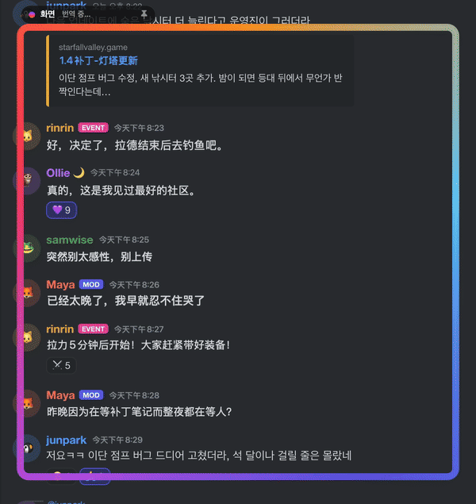

<p align="center">
  
</p>

<h1 align="center">AZET Lens</h1>
<p align="center"><a href="README.md">한국어</a> · <a href="README.en.md">English</a> · <a href="README.ja.md">日本語</a> · <b>简体中文</b></p>
<p align="center"><sub>基于 <a href="https://github.com/midagedev">midagedev</a> 的 <a href="https://github.com/midagedev/mwoyeo">Mwoyeo</a>（MIT）的分支：完全不联网，并可保存字幕记录。开发：<a href="https://azet.io">AZET</a></sub></p>
<p align="center"><b>不管什么画面，外文都在原处变成中文。</b><br>
把透镜罩在聊天、信息流或游戏画面上，原文随即消失，译文就写在原来的位置。</p>

<p align="center">
  <a href="https://github.com/azet-llc/azet-lens/releases/latest"></a>
  
  
  
  <a href="LICENSE"></a>
</p>

<p align="center"></p>

AZET Lens 会识别透镜下的文字，**把原文从画面上抹掉**，再按原来的位置、大小和颜色写上译文。没有弹窗，也没有字幕条，屏幕上直接就是中文（或你设定的其他语言）；新消息进来、页面滚动，翻译也一直跟着走。所有处理都在 Mac 本地完成，屏幕上的内容不会发往任何地方。

## 与 Mwoyeo 的不同

AZET Lens 只在 Mwoyeo 的基础上改了三处。透镜、抹除原文、翻译引擎、术语表、快捷键、12 种界面语言等其余部分，全部是 Mwoyeo 原本的成果。完整对比见 [docs/DIFFERENCES.md](docs/DIFFERENCES.md)。

| | Mwoyeo 1.0.4 | AZET Lens |
|---|---|---|
| **网络** | 每天向 GitHub 请求一次（检查更新、匿名统计安装数），可关闭 | **无，由 macOS 强制。** 在没有网络权限的 App Sandbox 中运行，App 发起的任何连接都会被系统拒绝。也不检查更新。[自己验证](#自己验证) |
| **记录** | 只显示译文 | 可开启：每个透镜把译过的每行及其在屏幕上的时间保存在内存中，可存为**字幕文件（.srt）**或附原文的文本 |
| **描边字幕** | 带黑色描边的白色字幕，译后变成无描边的深色文字、左对齐 | 保留文字颜色和描边，居中的字幕仍然居中（[实测](docs/DIFFERENCES.md#measured)） |
| 透镜、抹除、引擎、术语表、翻译记忆、快捷键、菜单栏 | ✓ | 相同 |

## 安装

到 [Releases](https://github.com/azet-llc/azet-lens/releases/latest) 下载磁盘映像，把 AZET Lens 拖进“应用程序”文件夹。App 由 AZET LLC 的 Developer ID 签名，并经过 Apple 公证。

AZET Lens 无法连接互联网，所以不会自己检查更新。新版本发布在 [Releases](https://github.com/azet-llc/azet-lens/releases)，在仓库页面选择 Watch › Custom › Releases 订阅后，GitHub 会通知你。

### 系统要求

| | |
|---|---|
| **macOS** | 27.0 或更高版本 |
| **Mac** | 能运行 macOS 27 的 Mac 都可以：Apple 芯片（M1 及更新机型）或 MacBook Neo。没有 Intel 版本。 |
| **权限** | 只需“屏幕录制”，不需要“辅助功能”，也不监听键盘 |
| **网络** | 不使用。这是没有网络权限的沙盒 App；语言包和 Apple Intelligence 模型由 macOS 自己下载 |
| **磁盘** | App 本身约 20 MB。语言包（以及 Apple Intelligence 模型，最多 8–14 GB）由 macOS 负责下载和存放。 |
| **显示器** | 数量不限，透镜可以放在任意一块显示器上 |

**本地运行的各个部分，以及各自的要求。** 所有处理都在 Mac 本地完成，差别只在于有哪个引擎可用。

| 功能 | 要求 |
|---|---|
| 识别文字（Vision）、擦除文字（Core ML） | 没有额外要求，能运行 macOS 27 的 Mac 都行 |
| 用**语言包**翻译（最快，可离线） | 对应语言组合的语言包，下载一次即可：在 AZET Lens 的“设置 › 翻译”或“系统设置 › 通用 › 语言与地区 › 翻译语言”中下载 |
| **不用语言包**翻译、*高保真*引擎、*术语表优先* | 在“系统设置 › Apple 智能与 Siri”中打开 **Apple Intelligence** |

能运行 macOS 27 的 Mac 都支持 Apple Intelligence，不过还有两个前提：Mac 的语言和 Siri 的语言必须是同一种受支持的语言；另外，中国大陆无法使用 Apple Intelligence。在 AZET Lens 支持的语言里，Apple Intelligence 支持英语、韩语、日语、中文、法语、德语、西班牙语、意大利语、葡萄牙语和越南语，不支持俄语、乌克兰语和泰语，这三种语言只能用语言包翻译。没有 Apple Intelligence 时，AZET Lens 全部改用语言包翻译。

**语言。** 英语、韩语、日语、中文（简体和繁体）、法语、德语、西班牙语、意大利语、葡萄牙语（巴西）、俄语、乌克兰语、越南语和泰语之间都能互译，前提是 macOS 有这个方向的翻译模型。选择*自动*时，会逐行识别源语言。App 界面支持英语、韩语、日语、中文（简体和繁体）、法语、德语、西班牙语、意大利语、葡萄牙语（巴西）、俄语和乌克兰语。

## 快速上手

1. **打开 AZET Lens。** AZET Lens 常驻菜单栏（取景器图标），欢迎窗口会带你走完剩下的步骤。
2. **允许屏幕录制。** 点按**允许**，然后在“系统设置 › 隐私与安全性 › 录屏与系统录音”中打开 AZET Lens。之后如果透镜里还是空的，退出 AZET Lens 再重新打开。
3. **选择语言。** *翻译自*保持**自动**即可；*翻译为*默认是 Mac 的系统语言。
4. **下载语言包**（推荐）。在 AZET Lens 的“设置 › 翻译”中，点按语言组合旁边的**下载**。装了语言包，翻译几乎是即时的，还能离线使用。不装的话改由 Apple Intelligence 翻译，不用下载，但每行大约要 0.5 秒。
5. **按 ⌃⌥L，拖拽框选**想看的文字，比如 Discord 频道的消息列表或 Reddit 帖子。也可以直接点按，透镜就放在点按的位置。操作时按住 ⌥，透镜会固定在屏幕上，而不是跟随窗口（见下文）。

## 使用透镜

- **移动**：拖动透镜发光的边框，或顶部的名称标签。译文始终贴在下方的文字上，只显示透镜范围内的部分。
- **调整大小**：拖动右下角。
- **关闭**：点按名称标签上的 ✕（指针移到透镜上才会出现）。
- **滚动、聊天照旧。** 透镜内部的点按会直接穿透下去，下面的页面照常可用。新消息一来就翻译，滚动时译文也跟着走。
- **窗口透镜与屏幕透镜。** 放在窗口上的透镜是*窗口透镜*（名称标签上显示 🪟），跟着窗口移动，窗口最小化或被遮住时会隐藏。*屏幕透镜*（📌）则停在你放的位置，不管下面是哪个 App 都照样翻译，适合放在字幕行上，或者下方经常切换 App 的地方。点按名称标签上的图标即可切换。
- **透镜越小越好。** 只框住要看的部分（框聊天区，别框整个浏览器），翻译更快，也更省电。可以同时开多个透镜。

菜单栏图标里会列出所有透镜，可以逐个开关、移除，或者添加新透镜。菜单里还有**显示原文**、**暂停**和设置。

### 快捷键

以下快捷键在任何 App 里都能用。可以在“设置 › 快捷键”中更改或移除：点按某个快捷键，再按下新的组合键。macOS 不会告诉 App 某组按键是否已被其他 App 占用，所以如果某个快捷键在别处也有作用，请换录一个。默认快捷键已经避开了 Rectangle、Magnet 等窗口管理工具。

| | |
|---|---|
| ⌃⌥L | 添加透镜（拖拽框选区域，或点按放置；按住 ⌥ 固定到屏幕） |
| ⌃⌥O | 显示原文 / 译文 |
| 无 | 全部暂停、重新翻译（在菜单中；需要的话可以在设置里为它们指定按键） |

## 设置

| 标签页 | 可以调整的内容 |
|---|---|
| 通用 | 语言 · **显示方式**：*自适应*（默认选项，画面移动时显示普通色块，静止后无缝重写）、*快速*（始终用色块，最省电）或*无缝*（始终重写）· 屏幕检查频率（4、8 或 15 fps）· 登录时打开 |
| 翻译 | **引擎**：*自动*（装了语言包就用语言包，否则用 Apple Intelligence）、*高保真*（始终用 Apple Intelligence）或*术语表优先* · 语言包 · **翻译记忆**：保留多少条译文供复用（1,000、5,000 或 20,000 条；只存在内存里，退出 AZET Lens 即清空）· **术语表**：专有名词，每行一条 `original = translation` |
| 外观 | **透镜样式**：*光晕*、*柔和*（只在读取时发光）或*极简*（一条淡淡的细线，悬停时才显示名称标签）· 字体（默认、圆体、衬线）· 色块不透明度 · 用 AI 擦除带纹理的背景（照片和插画） |

## 小技巧与常见问题

- **一直卡在“正在翻译…”？** 多半是没装语言包，到“设置 › 翻译”里下载即可。另外，安装后的第一个透镜也会慢一些，因为 macOS 要先加载一次文字识别模型。
- **名字翻得不对**（角色名、地名、用户名）？把它们加进术语表，再选*术语表优先*。
- **更新后什么都不显示？** macOS 有时会重新索要屏幕录制权限。到“系统设置”里确认一下，然后重新打开 AZET Lens。
- **想对照原文？** 按 ⌃⌥O 看原文，再按一次切回来。
- **隐私。** AZET Lens 只读取透镜下方的内容，截取画面时会把自己的叠加层排除在外。它什么都不发送，根本没有网络权限（见下文）。不开启记录就什么都不保留；开启后，在你保存到自己选择的文件之前，记录也只在内存里。

## 记录与保存字幕

在“设置 › 通用 › 为每个透镜保留记录”中开启后，每个透镜会把译过的每一行连同在屏幕上的时间保存下来。有记录的透镜会在菜单中显示 💬 数字，点按即可保存：

- **.srt**：译文字幕文件。把透镜放在视频的字幕行上，播放到结尾再保存，就得到这段视频的翻译字幕。
- **.txt**：逐行写出时间、译文和下方的原文。

记录只在内存中。关闭该设置、移除透镜或退出 App 后即删除；在“存储”面板中选好文件之前，不会向磁盘写入任何内容，App 也只能写入你选的那个文件。

## 自己验证

不联网不是一个需要你相信的设置，而是 macOS 强制执行的 App 签名权限。

```bash
codesign -d --entitlements - "/Applications/AZET Lens.app"
```

输出只有 `com.apple.security.app-sandbox` 和 `com.apple.security.files.user-selected.read-write` 两项。没有 `com.apple.security.network.client`，沙盒会拒绝所有向外的连接。在透镜翻译时打开 `nettop -p "AZET Lens"`，看不到任何连接。详见 [SECURITY.md](SECURITY.md)。

## 技术细节

每个环节用的都是 Apple 的设备端框架：

| 环节 | 技术 |
|---|---|
| 捕捉 | ScreenCaptureKit：每个透镜一路流，排除 AZET Lens 自己的叠加层，只在像素变化时输出帧 |
| 文字识别 | Vision `RecognizeDocumentsRequest`（段落）和 `RecognizeTextRequest`（行、感兴趣区域） |
| 翻译 | Translation 框架：有语言包时用低延迟的语言包，没有时用高保真的 Apple Intelligence 模型 |
| 按术语表翻译 | Foundation Models（设备端语言模型），可选 |
| 擦除 | 纹理背景在 GPU 上用 Core ML 版 MI-GAN 做图像修复，纯色背景用快速扩散填充 |
| 界面 | SwiftUI 搭配 Liquid Glass、菜单栏附加项、全局快捷键，界面支持 12 种语言 |

### 工作原理

```
ScreenCaptureKit ──► change map (16 px tiles) ──► scroll? shift blocks, read only the new strip
      │                       │
      │                       └─► changed rows ──► Vision (ROI) ──► erase ──► translate (lens first) ──► overlay
      │
      └─► still for 0.5 s ──► whole-frame paragraph pass ──► seamless re-render, cross-faded in
```

捕捉范围比透镜大一圈（即“过扫描”）。静止时，每边各留出相当于透镜尺寸约 30% 的余量；内容或透镜移动时扩大到约 40%，并向移动方向偏移。透镜可以在捕捉区域里自由移动，快到边缘时捕捉范围才重新居中，这时也只读取新露出来的条带。没变化的文字会沿用之前擦好的背景；内容移动期间算出的结果平移后继续用，不会丢掉；翻译队列也总是先处理看得见的内容。

滚动分两步跟踪。触控板和滚轮的输入会在下一帧到来之前，先让译文跟着页面移动；每捕捉到一帧，再按列测出精确到亚像素的偏移量，把译文校准到位，所以固定的侧边栏或消息输入框不会把聊天内容拖着走。只读取新滚入视野的那一条。

擦除时，纯色和渐变背景直接用周围的颜色填充；遇到有纹理的背景（插画、游戏画面），则由设备端的图像修复模型重建背景，译文也会用相应的字重和字号排版。

上面的动图是 AZET Lens 所基于的 Mwoyeo，运行在一个虚构的聊天页面（`demo/chat.html?lang=ko`）上，用真实的鼠标和触控板滚动录制。拍摄清单见 `docs/HERO.md`。

名字来自韩语方言：*mwoyeo*（뭐여）就是“那是啥？”的意思。

## 开发

构建、测试和发布的方法见[英文 README](README.en.md#development)。无界面测试工具请用没有沙盒的 Debug 版本运行。

## 致谢

AZET Lens 基于 [midagedev](https://github.com/midagedev) 的 [Mwoyeo](https://github.com/midagedev/mwoyeo)（MIT）。透镜、画面捕获与变化追踪、抹除原文、翻译引擎和界面都是他的作品，谢谢。如果只想用原版，请到那里下载。

图像修复模型：Picsart AI Research 的 [MI-GAN](https://github.com/Picsart-AI-Research/MI-GAN)，MIT 许可证（`tools/inpaint/models/LICENSE-MI-GAN-WEIGHTS`）。`tools/inpaint/models` 里的 Core ML 版本由 `tools/inpaint/convert_migan.sh` 转换而来。

## AZET 的其他 App

我们做把数据留在设备上的隐私与安全 App：[Sweep](https://azet.io/products/sweep)（拦截广告、追踪器和诈骗网站）· [AZET Pass](https://azet.io/products/pass)（端到端加密的密码管理器）· [AZET Care](https://azet.io/products/care-mac)（Mac、Windows、iPhone、Android 体检）· [AZET Shield](https://azet.io/products/shield)。联系：hello@azet.io

## 许可证

MIT
