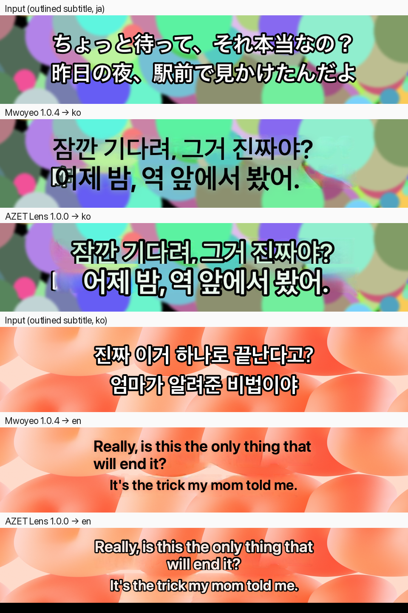

# AZET Lens and Mwoyeo

AZET Lens 1.0.0 is [Mwoyeo](https://github.com/midagedev/mwoyeo) 1.0.4 (commit `7d6c7ec`) with the changes below.
Everything not listed is Mwoyeo's code, unchanged. The full diff is `git diff 7d6c7ec..main` in this repository.

**The one change that matters:** AZET Lens cannot reach the network, and macOS enforces it.

| Area | Mwoyeo 1.0.4 | AZET Lens 1.0.0 | Where |
|---|---|---|---|
| **Network** | Daily request to GitHub for the latest version, plus `install.json` once and `month.json` monthly as anonymous counts; switch in Settings › About | **No network code and no network entitlement.** Release builds are sandboxed (`com.apple.security.app-sandbox`) with only `files.user-selected.read-write`; macOS refuses any connection. `scripts/release.sh` refuses a build that is not sandboxed or has a network entitlement | `App/Support/Updates.swift` removed · `App/Lens.entitlements` · `project.yml` · `scripts/release.sh` |
| **Transcript** | — | Off by default. When on, each lens keeps the (original, translation) lines it showed with their on-screen times, in memory; saved from the menu as `.srt` subtitles or `.txt` with originals; deleted on switch-off, lens removal or quit | `Core/Sources/MwoyeoCore/Transcript.swift` · `App/Model/AppModel.swift` · `App/Model/RegionSession.swift` · `App/UI/MenuPanel.swift` · `App/UI/SettingsView.swift` |
| **Outlined text** | The glyph mask keeps one of the two tones of outlined text (white letters, black edge): the other survives the erase, and the translation is drawn in the edge colour without an edge | Outlined text is detected (light and dark pixels that hug each other on a background that is neither); both tones are erased, the translation keeps the fill colour and gets the outline | `TextErase.outline(in:inner:background:)` · `BlockRenderer` stroke |
| **Centred lines** | Translations start at the original's left edge | Lines whose centres line up (and one outlined line) are drawn centred around the original's centre | `LineAlignment.isCentered` · `BlockRenderer` |
| Updates | In-app check, banner, Homebrew cask | GitHub Releases, watched by the user; no cask | `README*.md` |
| Release | CI on a `v*` tag with the Developer ID key in repository secrets | Built, signed (AZET LLC, `95P4H2RG24`) and notarized on AZET's release Mac only; CI workflows removed | `scripts/release.sh` |
| Name, bundle ID | Mwoyeo, `dev.midagedev.mwoyeo` | AZET Lens, `io.azet.lens` (Swift module stays `Mwoyeo`) | `project.yml`, string catalogs |
| Icon | Spectrum ring | Green-to-blue ring, same drawing | `scripts/make-icon.swift` |
| About | midagedev's contacts | hello@azet.io, link to Mwoyeo, both copyrights | `App/UI/SettingsView.swift` |
| Strings | 12 languages | Same 12; the 9 new strings are translated into all 11 non-English languages | `App/Resources/Localizable.xcstrings` |
| Lens, capture, change tracking, scroll prediction, erasing, MI-GAN inpainting, translation engines, glossary, translation memory, shortcuts, menu bar, onboarding, headless harness | ✓ | Same | — |

## Measured

Headless harness (`--render`, Debug build, this Mac: macOS 27.2, Apple Translation language packs), same input
images for both apps. Inputs are synthetic 1280×720 frames with Hiragino W6 / Apple SD Gothic Neo subtitles.

| Input | Mwoyeo 1.0.4 | AZET Lens 1.0.0 |
|---|---|---|
| Outlined Japanese subtitle over a busy picture, ja→ko | Same translation; drawn as dark text with no edge, left-aligned | Same translation; white letters with a black edge, centred |
| Outlined Korean subtitle over a photo, ko→en | Same translation; dark text, left-aligned, wrapped from the left | Same translation; white with edge, centred, wrapped around the centre |
| Plain subtitle on a flat dark background (ja→ko), light chat page (ja→ko), plain Korean on flat dark (ko→en) | — | **Identical output, 0 pixels differ** (no regression where there is no outline) |
| Release build, sandboxed, reading and writing inside its container | — | OCR, translation and MI-GAN erasing all work; the same lines as unsandboxed; reading a file outside the container is refused; `nettop` shows no connection from the app during the run |

Both apps translate the two Japanese lines to 「잠깐 기다려, 그거 진짜야?」「어제 밤, 역 앞에서 봤어.」 and the Korean ones to
"Really, is this the only thing that will end it?" / "It's the trick my mom told me." — the engine is the same.

A small piece of the first glyph at the left edge of the second Japanese line survives the erase in both apps (the
recognised line box starts a few pixels inside the glyph); that is Mwoyeo's behaviour and is not changed here.

Not yet checked live: the interactive lens with Screen Recording granted (shortcut, scroll tracking, window lens,
login item) in the sandboxed build. Those APIs (Carbon hot keys, ScreenCaptureKit, global mouse and scroll
monitors, `SMAppService`) are available to sandboxed apps, and the app starts sandboxed with no sandbox violation
logged, but the live run is still to do.

## Not changed, on purpose

- Translation quality is Apple's (Translation framework and Foundation Models); AZET Lens does not add its own
  model, so Korean, Japanese and English quality is the same as Mwoyeo's. The measured lines above are there to show
  what the engines produce, not a claim that AZET Lens translates better.
- The lens ring colours on screen are Mwoyeo's.
